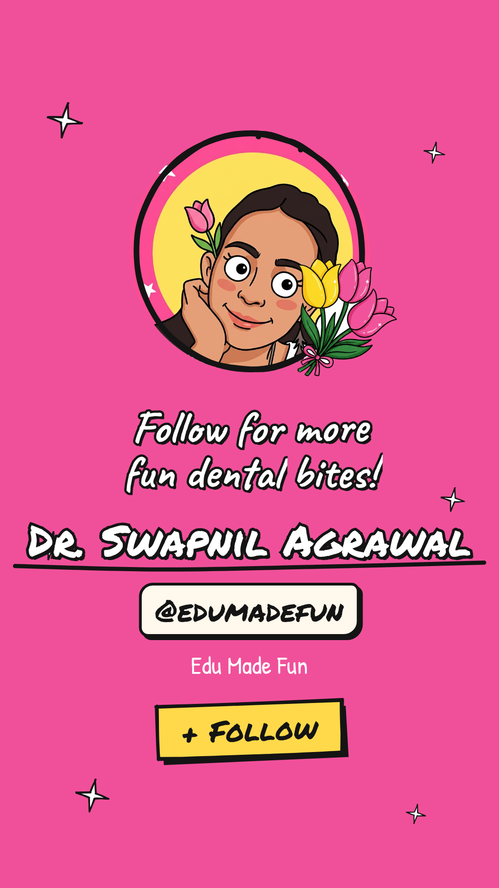
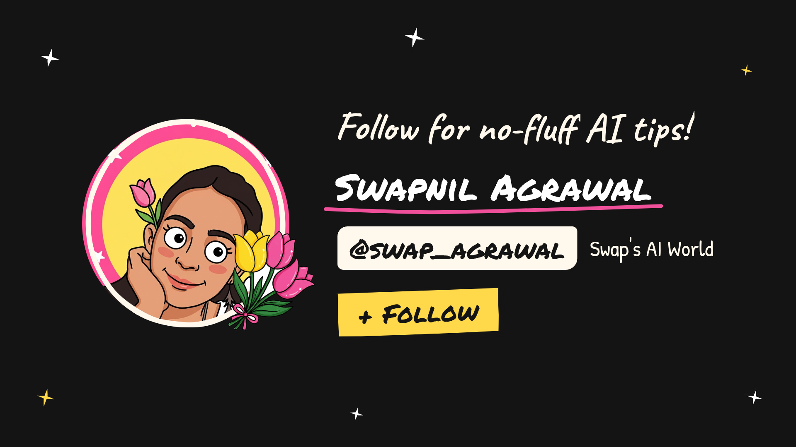

<div align="center">

# 🌷 Swap Studio

**A cloud video studio for doodle-style explainer reels.**
Frame-perfect [SwapDraws](https://github.com/swapagrawal14/swap-draws) rendering + a Remotion brand kit with hand-drawn titles, karaoke captions and end cards.


</div>

---

## ✨ What's inside

| Folder | What it does |
|---|---|
| [`swapdraws-renderer/`](swapdraws-renderer) | Turns a SwapDraws storyboard JSON into an MP4, drawing **every frame** with the app's own engine. No dropped frames, voiceover in sync. |
| [`brand-kit/`](brand-kit) | Remotion components in the Swap brand style: pink `#F0509A`, yellow `#FFD94A`, black ink, tulips. |
| [`docs/instabox-setup.md`](docs/instabox-setup.md) | How the cloud machine is set up and controlled. |

### Brand kit components
- **TitleCard**: the title writes itself in word by word, with a marker swipe, tulips and sparkles
- **WordCaptions**: karaoke captions where each word pops yellow as it's spoken (free edge-tts voice + word timings)
- **HighlightSwipe · WobblyUnderline · ArrowCircle**: rough, hand-drawn accents, seeded so every render matches
- **LowerThird**: name strip with a tulip
- **EndCard**: avatar, name, handle and Follow button, with **Edu Made Fun** (pink) and **Swap's AI World** (ink) themes
- **SwapDrawsClip**: wraps any SwapDraws MP4 with a branded intro and outro, using a brush-stroke wipe
- Every component works in both **9:16** (reels / Shorts) and **16:9** (YouTube)

<p>



</p>

## 🚀 Quick start

```bash
# Brand kit
cd brand-kit && npm install
./render.sh BrandShowcase demo/edu_showcase.json out/edu.mp4
./render.sh IntroOutro    demo/ai_intro.json     out/ai.mp4

# SwapDraws renderer (needs Chromium + ffmpeg)
cd swapdraws-renderer
./render.sh my-story.swapdraws.json out.mp4 --fps 30 --size 1080x1920
```

Props JSON picks the look: `"channel": "edu" | "ai"` and `"format": "9:16" | "16:9"`. Add `"voiceText"` and the voiceover plus caption timings are made for you.

## ☁️ Why a cloud machine?

Rendering video takes a real browser and lots of CPU. Swap Studio runs on a free [Instabox](https://instabox.sh) machine (4 vCPU / 8 GB). It wakes up to render and pauses when it's idle. A 64-second reel renders in about **54 s**, and a 12-second branded clip in about **33 s**.

## 📜 License

The Swap Studio code is MIT. The avatar, tulip art and brand assets belong to Swapnil Agrawal; please don't reuse them as your own brand.
[Remotion](https://remotion.dev/license) has its own license: it's free for individuals and teams of up to 3.

<div align="center">
Made with 🤍🥀 by <b>Dr. Swapnil Agrawal</b>, dentist, author and AI creator
</div>
