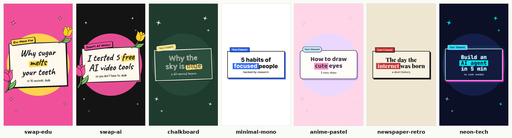

# 🎨 Style packs

A **style pack** is one folder with one `style.json`. It decides every colour, font, accent, decoration, voice, end card and caption look the brand kit draws, so the same compositions can make videos in *any* style, not just Swapnil's.

| Pack | Look | For |
|---|---|---|
| `swap-edu` | hot pink + yellow, Caveat / Permanent Marker, tulips, rough doodle accents | **Edu Made Fun** (Swapnil only) |
| `swap-ai` | ink black + pink/yellow, same fonts, tulips | **Swap's AI World** (Swapnil only) |
| `chalkboard` | dark green board, chalk white + yellow, Cabin Sketch / Schoolbell, rough accents | lessons, science, school topics |
| `minimal-mono` | white, black, one cobalt-blue accent, Inter, clean lines, no sparkles | productivity, business, "serious but friendly" |
| `anime-pastel` | pastel pink / lavender / sky, rounded Baloo 2 + Nunito, sparkles, soft rounded cards | cute, art, lifestyle, fandom |
| `newspaper-retro` | cream newsprint, Playfair Display + Lora serif, brick-red accent, UPPERCASE captions | history, news, storytelling |
| `neon-tech` | dark navy, cyan + magenta glow, JetBrains Mono | tech, coding, AI, gaming |

The neutral packs (everything except `swap-*`) carry **placeholders** on the end card ("Your Name", "@yourhandle", initials instead of an avatar). Override them per video (see below) or copy the pack and make it yours. Swapnil's avatar and tulips are her brand: don't use them in your own pack.



## Picking a pack in props

```jsonc
{ "style": "neon-tech", "format": "9:16", "title": "Build an AI agent in 5 min", "highlight": "AI agent" }
```

Override a few fields without making a new pack (`extends` fills in everything else):

```jsonc
{
  "style": {
    "extends": "minimal-mono",
    "colors": { "accent": "#FF5A1F", "shadow": "#FF5A1F", "underline": "#FF5A1F", "mark": "#FF5A1F" },
    "captions": { "highlightColor": "#FF5A1F" },
    "endCard": { "name": "Priya Sharma", "handle": "@priyacodes", "channel": "Priya Codes", "avatar": "/abs/path/priya.jpg" }
  },
  "title": "Git in 60 seconds"
}
```

Or inline a complete pack (same shape as `style.json`). Legacy `"channel": "edu" | "ai"` still works and means `swap-edu` / `swap-ai`. `"theme": {...}` low-level overrides still work too.

List packs on the render machine: `./render.sh --styles`.

## `style.json` fields

Machine-readable schema: [`style.schema.json`](style.schema.json) (add `"$schema": "../style.schema.json"` to get autocomplete in VS Code).

| Field | Required | What it does |
|---|---|---|
| `name` | ✓ | pack id, same as the folder name (`my-style`) |
| `label` | | human name |
| `extends` | | inherit another pack and only override what you set |
| `kicker` | | default text of the little tag above the title card |
| `colors.bg / paper / ink / accent / accent2` | ✓ | background · card colour · text + outlines on the card · main accent · second accent |
| `colors.*` (optional) | | `sun` (circle behind title, `"none"` hides), `textOnBg`, `shadow`, `ring`, `underline`, `mark`, `dots`, `sparkle`, `sparkleOutline`, `wipe`, `wipe2`, `wipeOutline`, `highlightText`, `tagText`. Defaults are derived from the five core colours. Use `highlightText`/`tagText` when the accent is dark (white text on a blue bar). |
| `fonts.title / body / caption` | ✓ | each is a Google Fonts family name (`"Inter"`) **or** `{family, weight, src, fallback, scale}`. `src` = a woff2: `fonts/X.woff2` (bundled in `brand-kit/public/fonts`), `./X.woff2` (inside the pack folder) or an https url. No `src` = fetched from Google Fonts at render time (needs internet). `scale` shrinks/grows the font: sizes were tuned for narrow handwriting, so wide fonts want about `0.55–0.7`. Optional `fonts.label` for tags/name/handle/button (defaults to caption). |
| `accents` | | `"rough"` hand-drawn rough.js wobble + playful tilts · `"clean"` same accents with straight lines, no tilt · `"none"` no underline/circle accents and no sparkles |
| `sparkles` | | twinkling stars on/off (default on unless `accents: "none"`) |
| `radius` | | corner radius for clean cards, tags, buttons (px at 1080 wide) |
| `glow` | | neon glow on title + card |
| `decorations` | | transparent PNGs made by an image model, popped in around the cards (slot 0 bottom-left of the title, 1 top-right, 2 by the avatar). `img/x.png` = `brand-kit/public`, `./x.png` = pack folder |
| `imageStylePrompt` | | the style sentence an AI must append to **every** illustration prompt for this pack, so images match. Always ends with "no text". |
| `voice` | | `{ "name": "en-US-AriaNeural", "rate": "+5%" }`, an edge-tts voice for `voiceText` (props `voice` / `voiceRate` still win) |
| `endCard` | | `{name, handle, channel, cta, avatar?, button?, ctaOutline?}`. No avatar = initials in a circle. |
| `captions` | | `{highlightColor, case: "none"|"upper"|"lower", color?, stroke?}`; `stroke: "none"` turns off the outline |

Asset paths starting with `./` are relative to the pack folder (for packs) or to the props file (for inline styles); `render.sh` copies them into the render automatically.

Make your own: see [`_template/README.md`](_template/README.md).
